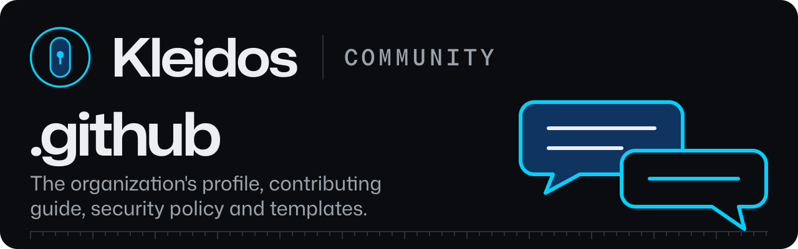

<!-- BEGIN GENERATED: banner (kleidos-dev/social, tools/sync_readme_banners.py); do not edit by hand -->

<picture>
  <source media="(prefers-color-scheme: dark)" srcset=".github/readme/banner-dark.svg">
  <source media="(prefers-color-scheme: light)" srcset=".github/readme/banner-light.svg">
  
</picture>

<!-- END GENERATED: banner -->

# kleidos-dev/.github

This repository holds the kleidos-dev organization's profile, its community defaults, and its Discussions. It contains no firmware; its only code is the commit-message gate and the tools that write and check the metadata of the profile's images.

| Path | What it is |
| --- | --- |
| [`profile/README.md`](profile/README.md) | The organization's public landing page on GitHub. |
| [`profile/assets/`](profile/assets/) | The profile banners (dark and light) and `assets.json`, the record of what each banner says about itself and its SHA-256. |
| [`.github/readme/`](.github/readme/) | The banner at the top of this page: a byte copy of the [`social`](https://github.com/kleidos-dev/social) repository's, with its `SHA256SUMS`, written by social's `tools/sync_readme_banners.py`. The profile keeps its own banner. |
| [`.github/FUNDING.yml`](.github/FUNDING.yml) | The two donation routes, used by every repository that has no funding file of its own and has Sponsorships turned on. |
| [`SECURITY.md`](SECURITY.md) | How to report a vulnerability privately; the default for every repository without its own policy. |
| [`CONTRIBUTING.md`](CONTRIBUTING.md) | Where to ask, how a new board gets added, and the license of contributions; the default for every repository without its own guide. |
| [`CODE_OF_CONDUCT.md`](CODE_OF_CONDUCT.md) | The Contributor Covenant 2.1, for every repository and for Discussions. |
| [`SUPPORT.md`](SUPPORT.md) | Where questions, board requests, and vulnerabilities go. |
| [`.github/ISSUE_TEMPLATE/`](.github/ISSUE_TEMPLATE/) | The default issue form, with questions sent to Discussions and vulnerabilities to the security policy. |
| [`.github/PULL_REQUEST_TEMPLATE.md`](.github/PULL_REQUEST_TEMPLATE.md) | The default pull request description. |
| [`.github/VULNERABILITY_REPORT.yml`](.github/VULNERABILITY_REPORT.yml) | The default form for a private vulnerability report. |
| [`.github/DISCUSSION_TEMPLATE/new-board-requests.yml`](.github/DISCUSSION_TEMPLATE/new-board-requests.yml) | The form behind the New board requests category. |
| [`docs/discussion-categories.md`](docs/discussion-categories.md) | The Discussions categories and the pinned welcome post. |
| [`scripts/`](scripts/), [`tests/`](tests/) | The media metadata tools (`media_meta.py`, `stamp_media_meta.py`, `check_metadata.py`) and their tests. |
| [`.github/workflows/`](.github/workflows/) | The commit-message gate and the media metadata gate (`media-check.yml`). |
| [`.github/dependabot.yml`](.github/dependabot.yml) | Weekly updates of the pinned GitHub Actions. |
| [`REUSE.toml`](REUSE.toml), [`LICENSES/`](LICENSES/) | The license and copyright of every file, in the [REUSE](https://reuse.software/) format, and the license texts. |

Kleidos itself is described at <https://kleidos.dev>.

## Media metadata

Every image this repository publishes carries metadata that says what it is, who made it and under which license, for readers and for search engines: a descriptive `<title>` and `<desc>`, and a Dublin Core and ccREL `<metadata>` block with the creator, the rights line, the license URL, the file's URL, keywords and the IPTC digital source type. The block sits between `REUSE-IgnoreStart` and `REUSE-IgnoreEnd` comments, so the REUSE tool takes the license and holders from `REUSE.toml` alone. This is the profile `kleidos-media-meta/1` that every kleidos-dev repository follows.

Nobody writes that metadata by hand. Each file's record in [`profile/assets/assets.json`](profile/assets/assets.json) holds its title, description, keywords and source type; the license and holders come from `REUSE.toml`. After changing a banner or its record:

```sh
python3 scripts/stamp_media_meta.py --write   # writes the metadata and records the SHA-256
python3 scripts/check_metadata.py             # checks the profile, REUSE and the privacy deny-list
python3 -m unittest discover -s tests         # the tools' own tests
```

The stamp rewrites only the root `<svg>`'s `role`, `aria-labelledby` and `lang` and the title, description and metadata that follow it; the drawing is never touched. The checker refuses any e-mail address, local path, host name, machine time or tool name in the metadata, and identity patterns kept out of the repository (the `KLEIDOS_DENY_EXTRA` secret in CI, or an untracked `scripts/deny-local.txt`). The `media-check` workflow and the pre-commit hooks run the same commands.

## License

The text and the banners in this repository are licensed under the [GNU General Public License, version 3 or later](https://www.gnu.org/licenses/gpl-3.0.html) (GPL-3.0-or-later), except [`CODE_OF_CONDUCT.md`](CODE_OF_CONDUCT.md), which is adapted from the [Contributor Covenant](https://www.contributor-covenant.org/) 2.1 (CC BY 4.0). The tooling (the commit-message gate copied from kleidos-dev/agents, the media metadata tools, their tests and the CI configuration) is under the MIT License, so the other kleidos-dev repositories can share it. [`REUSE.toml`](REUSE.toml) states the license of every file, and the texts are in [`LICENSES/`](LICENSES/); the full text of the GPL is also in [`LICENSE`](LICENSE). Every other Kleidos repository states its own license in its `LICENSE` file.
