<!--
SPDX-FileCopyrightText: 2026 José M. Requena Plens
SPDX-License-Identifier: GPL-3.0-or-later
-->

<picture>
  <source media="(prefers-color-scheme: dark)" srcset="assets/banner-dark.svg">
  <source media="(prefers-color-scheme: light)" srcset="assets/banner-light.svg">
  
</picture>

**Free firmware that turns one of nine small ESP32 boards from M5Stack and LILYGO into a hardware password manager.** It keeps your passwords encrypted on the board and types the one you pick into your computer or phone over Bluetooth, only after you unlock the board itself. No app, no cloud.

**[Not released yet](https://kleidos.dev/roadmap/).** The firmware's source is private while the first release is prepared.

**Public now:** [boards](https://github.com/kleidos-dev/boards) (drawings, schematics and 3D models of the boards) · [brand](https://github.com/kleidos-dev/brand) (logo, type, colors, press kit, profile images and preview cards).

**ESP32-S3:** [M5StickS3](https://kleidos.dev/overview/sticks3/) · [M5Cardputer&nbsp;ADV](https://kleidos.dev/overview/cardputer/) · [LILYGO&nbsp;T&#8209;Deck&nbsp;Plus](https://kleidos.dev/overview/tdeck-plus/) · [M5Stack&nbsp;CoreS3&nbsp;SE](https://kleidos.dev/overview/cores3-se/) **ESP32:** [M5StickC&nbsp;Plus2](https://kleidos.dev/overview/m5stickc-plus2/) · [M5StickC&nbsp;Plus&nbsp;1.1](https://kleidos.dev/overview/m5stickc-plus1/) · [M5StickC&nbsp;Plus&nbsp;SE](https://kleidos.dev/overview/m5stickc-plus-se/) · [M5Stack&nbsp;CoreInk](https://kleidos.dev/overview/coreink/) · [M5Stack&nbsp;Core2&nbsp;v1.3](https://kleidos.dev/overview/m5stack-core2-v13/) Want another board? Ask in [New board requests](https://github.com/orgs/kleidos-dev/discussions/categories/new-board-requests).

**[kleidos.dev](https://kleidos.dev)** · [Discussions](https://github.com/orgs/kleidos-dev/discussions) · [Contributing](https://github.com/kleidos-dev/.github/blob/main/CONTRIBUTING.md) · [Code of conduct](https://github.com/kleidos-dev/.github/blob/main/CODE_OF_CONDUCT.md) · [Donate](https://github.com/kleidos-dev/.github/blob/main/CONTRIBUTING.md#helping-with-a-board)

> **Found a vulnerability?** Never report it in Discussions, in an issue, or in a pull request. Report it privately, as the [security policy](https://github.com/kleidos-dev/.github/blob/main/SECURITY.md) describes.

Kleidos is licensed under [GPL-3.0-or-later](https://www.gnu.org/licenses/gpl-3.0.html); each repository states its own license in its `LICENSE` file.
